# Image review

<!-- Generated by tools/images/build-images.mjs from data/images/*.json. Do not edit by hand. -->

Every pairing of a civics question and a picture, for the owner to check. `question-images.json` is marked `needsHumanReview`: a picture is shown only after the answer is graded and in Study first, but a wrong pairing would still mislead. Check that each picture fits the question and does not suggest a wrong answer.

86 of 228 questions have a picture.

Write OK (or a note) in the last column once a pairing is checked.

## Federal pictures

| Question | Text | Picture | Caption | Source | Rights | Owner OK |
|---|---|---|---|---|---|---|
| 2008-001 | What is the supreme law of the land? |  `public/images/civics/constitution-page-one.webp` | The U.S. Constitution, page 1 | <https://catalog.archives.gov/id/1667751> | Use restriction: Unrestricted. Access restriction: Unrestricted. |  |
| 2008-002 | What does the Constitution do? |  `public/images/civics/constitution-page-one.webp` | The U.S. Constitution, page 1 | <https://catalog.archives.gov/id/1667751> | Use restriction: Unrestricted. Access restriction: Unrestricted. |  |
| 2008-003 | The idea of self-government is in the first three words of the Constitution. What are these words? |  `public/images/civics/constitution-page-one.webp` | The U.S. Constitution, page 1 | <https://catalog.archives.gov/id/1667751> | Use restriction: Unrestricted. Access restriction: Unrestricted. |  |
| 2008-005 | What do we call the first ten amendments to the Constitution? |  `public/images/civics/bill-of-rights.webp` | The Bill of Rights | <https://catalog.archives.gov/id/1408042> | Use restriction: Unrestricted. Access restriction: Unrestricted. |  |
| 2008-008 | What did the Declaration of Independence do? |  `public/images/civics/declaration-of-independence-engraving.webp` | Declaration of Independence | <https://www.si.edu/object/npg_NPG.80.129> | Restrictions & Rights: CC0 |  |
| 2008-009 | What are two rights in the Declaration of Independence? |  `public/images/civics/declaration-of-independence-engraving.webp` | Declaration of Independence | <https://www.si.edu/object/npg_NPG.80.129> | Restrictions & Rights: CC0 |  |
| 2008-015 | Who is in charge of the executive branch? |  `public/images/civics/white-house-1906.webp` | The White House, Washington | <https://www.loc.gov/item/97509460/> | No known restrictions on publication. |  |
| 2008-016 | Who makes federal laws? | 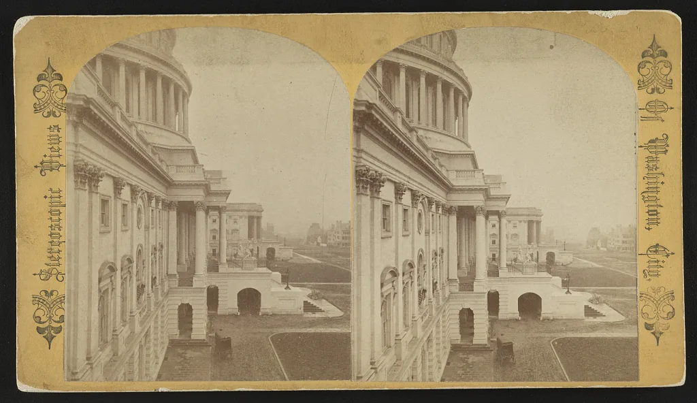 `public/images/civics/us-capitol-1875.webp` | United States Capitol | <https://www.loc.gov/item/2005684916/> | No known restrictions on publication. |  |
| 2008-017 | What are the two parts of the U.S. Congress? |  `public/images/civics/us-capitol-1875.webp` | United States Capitol | <https://www.loc.gov/item/2005684916/> | No known restrictions on publication. |  |
| 2008-038 | What is the highest court in the United States? | 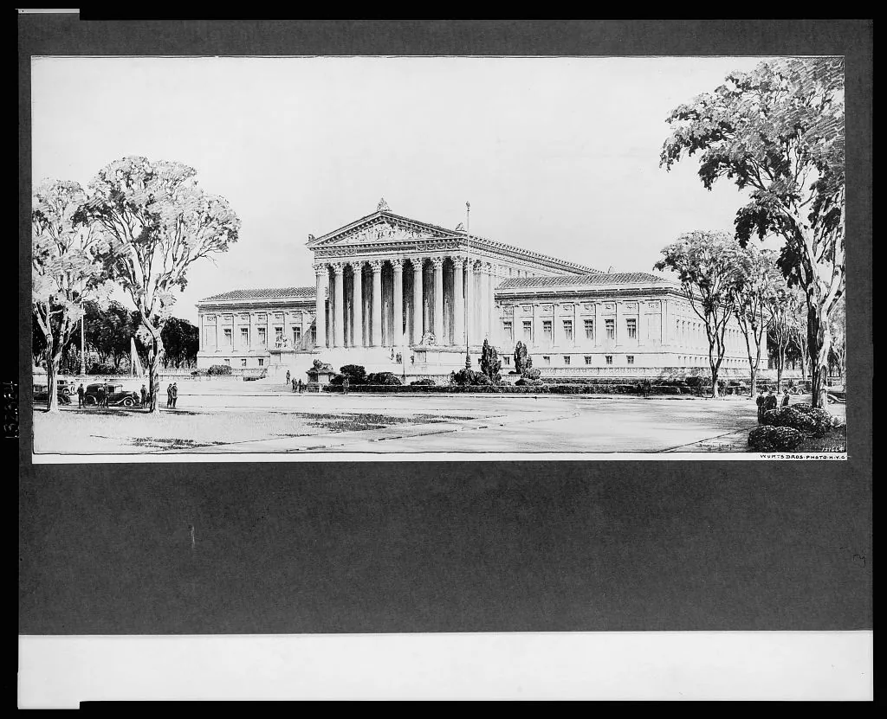 `public/images/civics/supreme-court-1931.webp` | The new United States Supreme Court / Schell Lewis ; Wurts Bros. Photo, N.Y.C. | <https://www.loc.gov/item/2002722643/> | No known restrictions on publication. |  |
| 2008-052 | What do we show loyalty to when we say the Pledge of Allegiance? | 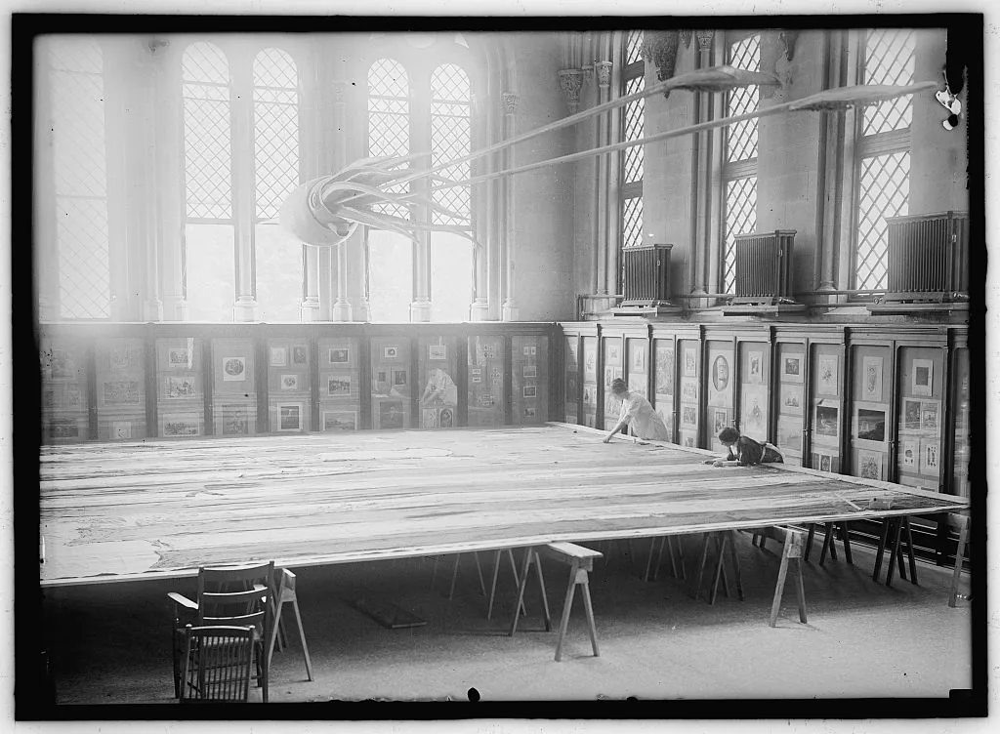 `public/images/civics/american-flag-1914.webp` | FLAGS. HUGE AMERICAN FLAG | <https://www.loc.gov/item/2016865574/> | No known restrictions on publication. For more information, see Harris & Ewing Photographs - Rights and Restrictions Information https://www.loc.gov/rr/print/res/140_harr.html |  |
| 2008-061 | Why did the colonists fight the British? | 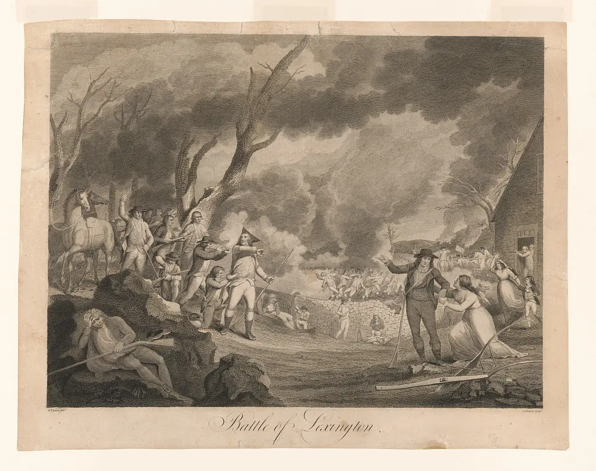 `public/images/civics/battle-of-lexington.webp` | The Battle of Lexington, 1775 | <https://www.loc.gov/item/2004669978/> | No known restrictions on publication. |  |
| 2008-062 | Who wrote the Declaration of Independence? | 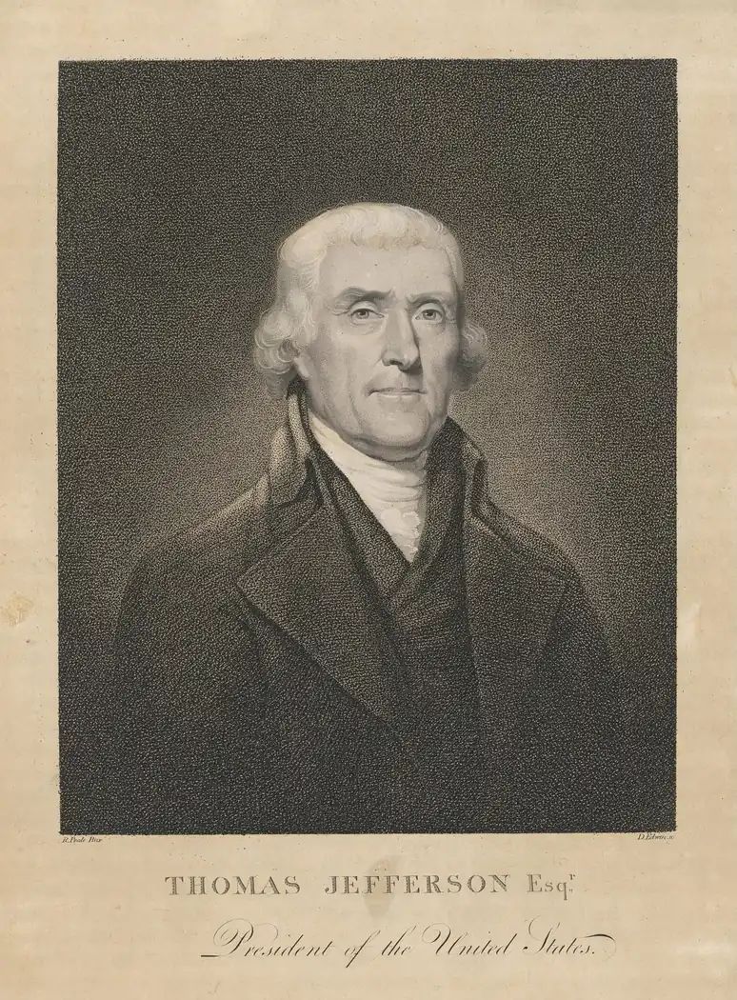 `public/images/civics/thomas-jefferson-edwin.webp` | Thomas Jefferson | <https://www.si.edu/object/npg_NPG.94.134> | Restrictions & Rights: CC0 |  |
| 2008-063 | When was the Declaration of Independence adopted? |  `public/images/civics/declaration-of-independence-engraving.webp` | Declaration of Independence | <https://www.si.edu/object/npg_NPG.80.129> | Restrictions & Rights: CC0 |  |
| 2008-065 | What happened at the Constitutional Convention? |  `public/images/civics/constitution-signing-poster.webp` | The Constitution of the United States "the signing" | <https://www.loc.gov/item/2018756662/> | No known restrictions on publication. For information see: "Popular Graphic Arts," https://hdl.loc.gov/loc.pnp/res.248.pga |  |
| 2008-066 | When was the Constitution written? |  `public/images/civics/constitution-page-one.webp` | The U.S. Constitution, page 1 | <https://catalog.archives.gov/id/1667751> | Use restriction: Unrestricted. Access restriction: Unrestricted. |  |
| 2008-068 | What is one thing Benjamin Franklin is famous for? |  `public/images/civics/benjamin-franklin-chevillet.webp` | Benjamin Franklin | <https://www.si.edu/object/npg_NPG.77.219> | Restrictions & Rights: CC0 |  |
| 2008-069 | Who is the “Father of Our Country”? | 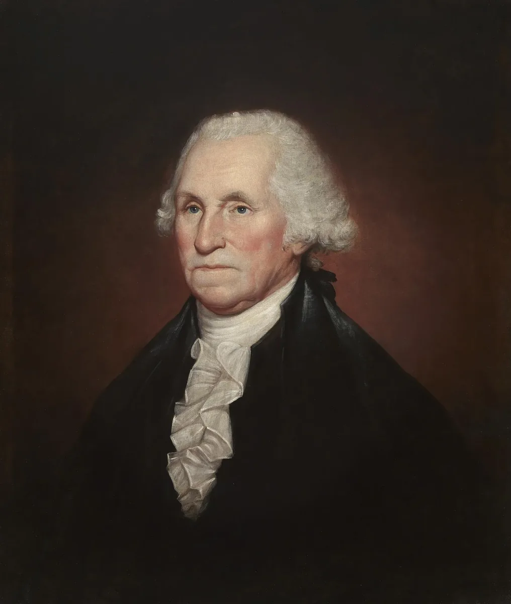 `public/images/civics/george-washington-peale.webp` | George Washington | <https://www.si.edu/object/npg_NPG.65.59> | Restrictions & Rights: CC0 |  |
| 2008-070 | Who was the first President? |  `public/images/civics/george-washington-peale.webp` | George Washington | <https://www.si.edu/object/npg_NPG.65.59> | Restrictions & Rights: CC0 |  |
| 2008-071 | What territory did the United States buy from France in 1803? |  `public/images/civics/louisiana-purchase.webp` | From the Louisiana Purchase papers, 1803 | <https://catalog.archives.gov/id/299807> | Use restriction: Unrestricted. Access restriction: Unrestricted. |  |
| 2008-072 | Name one war fought by the United States in the 1800s. |  `public/images/civics/battle-of-gettysburg.webp` | The Battle of Gettysburg, 1863 | <https://www.loc.gov/item/2006678602/> | No known restrictions on publication. |  |
| 2008-073 | Name the U.S. war between the North and the South. |  `public/images/civics/battle-of-gettysburg.webp` | The Battle of Gettysburg, 1863 | <https://www.loc.gov/item/2006678602/> | No known restrictions on publication. |  |
| 2008-074 | Name one problem that led to the Civil War. |  `public/images/civics/battle-of-gettysburg.webp` | The Battle of Gettysburg, 1863 | <https://www.loc.gov/item/2006678602/> | No known restrictions on publication. |  |
| 2008-075 | What was one important thing that Abraham Lincoln did? | 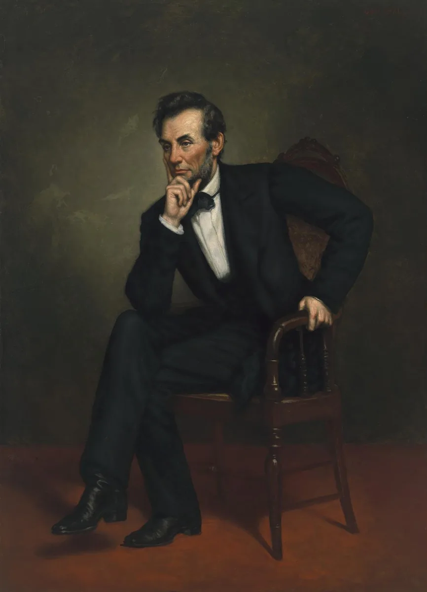 `public/images/civics/abraham-lincoln-healy.webp` | Abraham Lincoln | <https://www.si.edu/object/npg_NPG.65.50> | Restrictions & Rights: CC0 |  |
| 2008-076 | What did the Emancipation Proclamation do? | 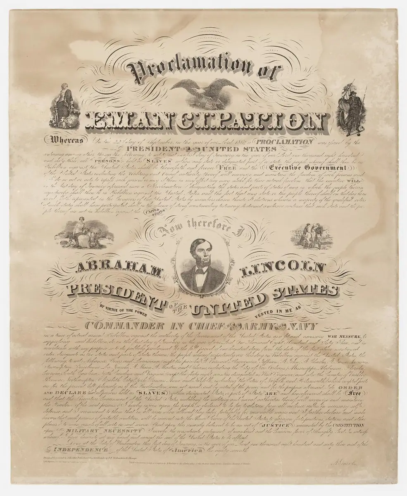 `public/images/civics/emancipation-proclamation-print.webp` | Emancipation Proclamation | <https://www.si.edu/object/npg_NPG.81.47> | Restrictions & Rights: CC0 |  |
| 2008-077 | What did Susan B. Anthony do? |  `public/images/civics/susan-b-anthony-sarony.webp` | Susan B. Anthony | <https://www.loc.gov/item/2012646556/> | No known restrictions on publication. |  |
| 2008-078 | Name one war fought by the United States in the 1900s. | 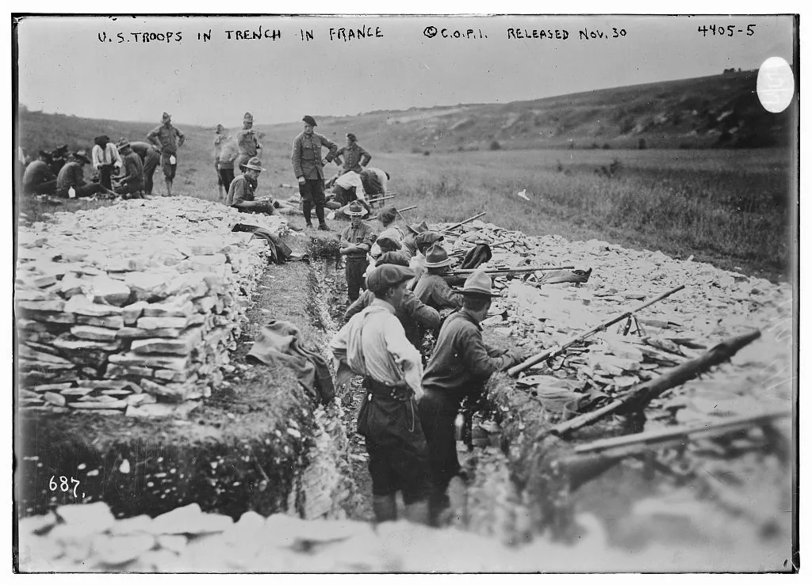 `public/images/civics/world-war-one-trench.webp` | U.S. soldiers in a trench in France, World War I | <https://www.loc.gov/item/2014705883/> | No known restrictions on publication. For more information, see George Grantham Bain Collection - Rights and Restrictions Information https://www.loc.gov/rr/print/res/274_bain.html |  |
| 2008-079 | Who was President during World War I? |  `public/images/civics/woodrow-wilson-tarbell.webp` | Woodrow Wilson | <https://www.si.edu/object/npg_NPG.65.42> | Restrictions & Rights: CC0 |  |
| 2008-080 | Who was President during the Great Depression and World War II? | 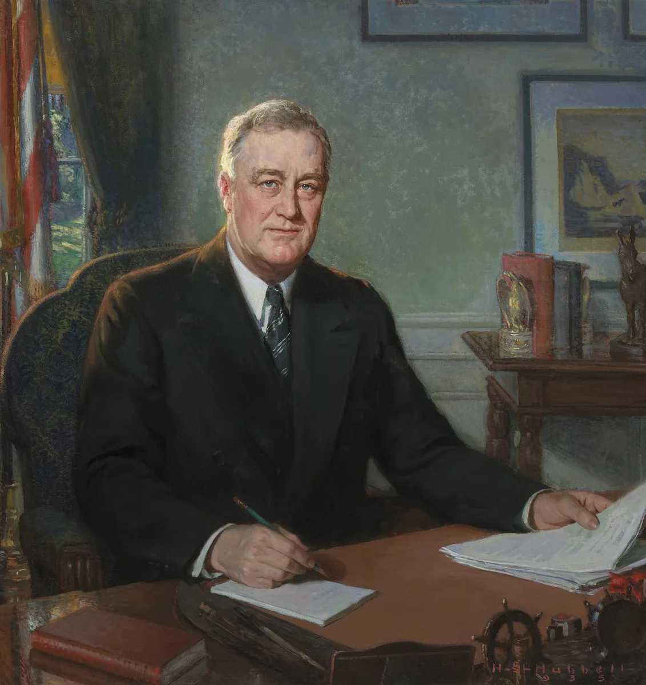 `public/images/civics/franklin-d-roosevelt-hubbell.webp` | Franklin D. Roosevelt | <https://www.si.edu/object/npg_NPG.66.68> | Restrictions & Rights: CC0 |  |
| 2008-082 | Before he was President, Eisenhower was a general. What war was he in? |  `public/images/civics/dwight-d-eisenhower-warnecke.webp` | Dwight D. Eisenhower | <https://www.si.edu/object/npg_NPG.94.45> | Restrictions & Rights: CC0 |  |
| 2008-084 | What movement tried to end racial discrimination? |  `public/images/civics/march-on-washington-1963.webp` | The March on Washington for civil rights, 1963 | <https://catalog.archives.gov/id/542045> | Use restriction: Unrestricted. Access restriction: Unrestricted. |  |
| 2008-085 | What did Martin Luther King, Jr. do? | 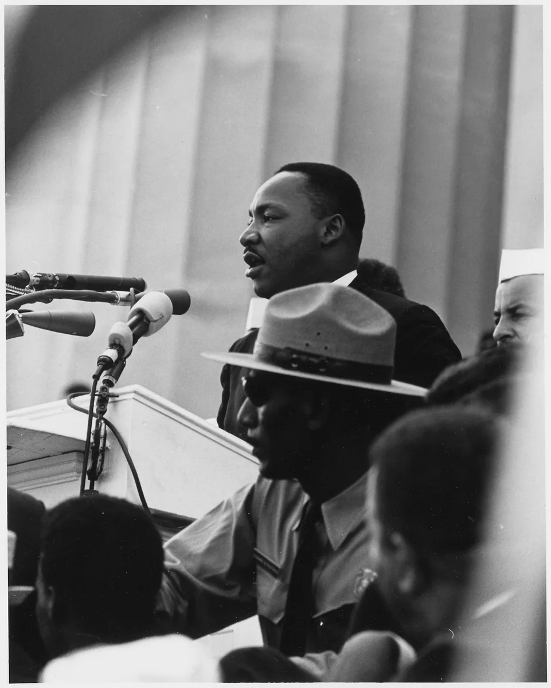 `public/images/civics/martin-luther-king-march-1963.webp` | Dr. Martin Luther King, Jr. at the March on Washington, 1963 | <https://catalog.archives.gov/id/542069> | Use restriction: Unrestricted. Access restriction: Unrestricted. |  |
| 2008-094 | What is the capital of the United States? | 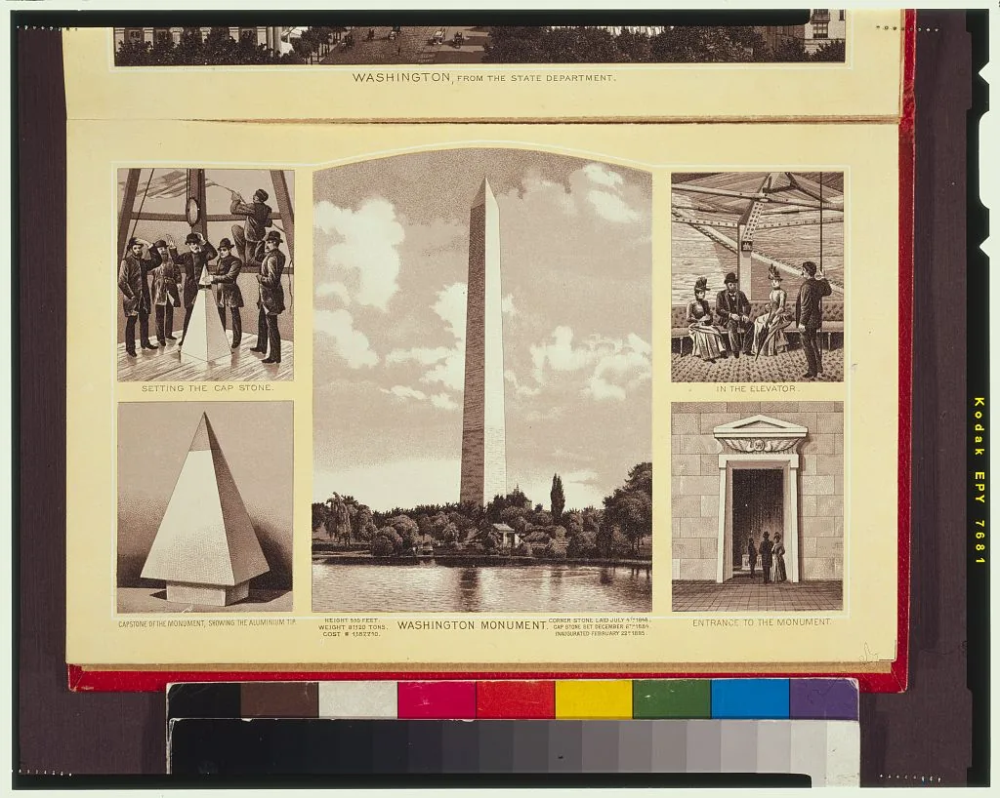 `public/images/civics/washington-monument-1889.webp` | Washington Monument | <https://www.loc.gov/item/2007680368/> | No known restrictions on publication. |  |
| 2008-095 | Where is the Statue of Liberty? | 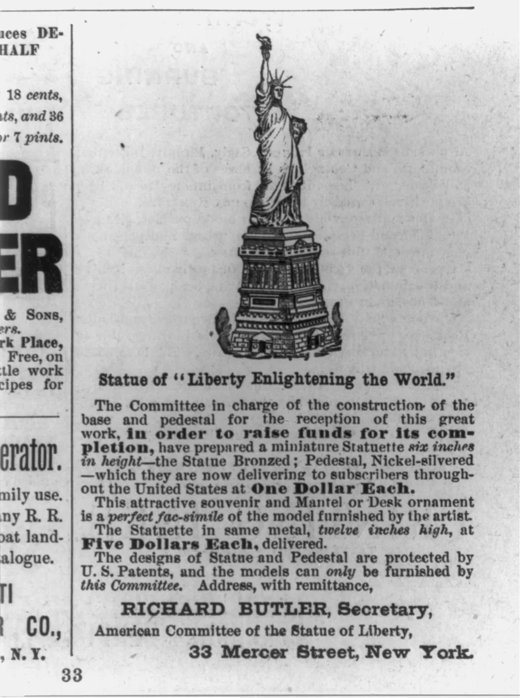 `public/images/civics/statue-of-liberty-1885.webp` | Statue of "Liberty Enlightening the World" | <https://www.loc.gov/item/2002715404/> | No known restrictions on publication. |  |
| 2008-096 | Why does the flag have 13 stripes? |  `public/images/civics/american-flag-1914.webp` | FLAGS. HUGE AMERICAN FLAG | <https://www.loc.gov/item/2016865574/> | No known restrictions on publication. For more information, see Harris & Ewing Photographs - Rights and Restrictions Information https://www.loc.gov/rr/print/res/140_harr.html |  |
| 2008-098 | What is the name of the national anthem? | 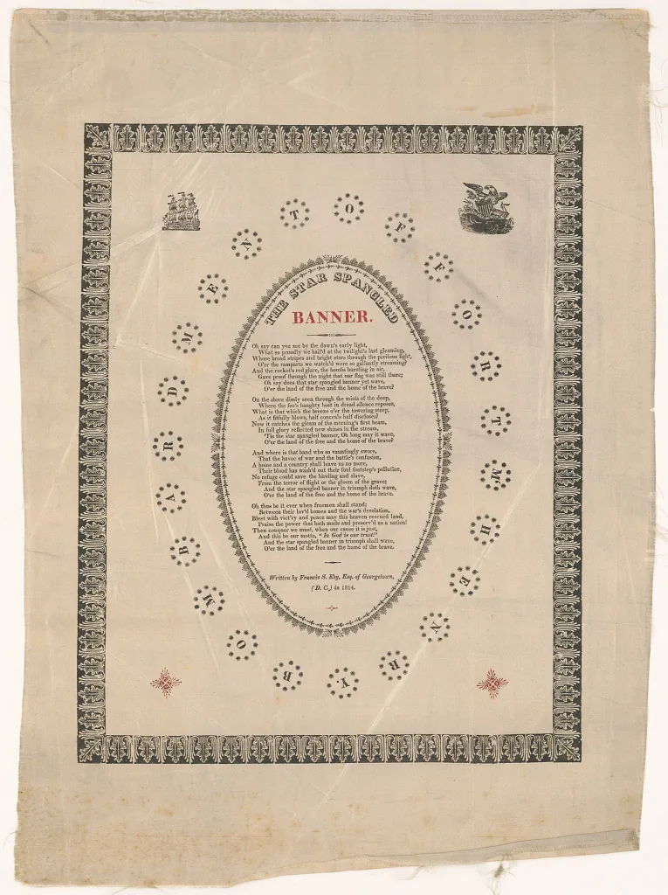 `public/images/civics/star-spangled-banner-music.webp` | The star spangled banner / written by Francis S. Key, Esq. of Georgetown, (D.C.) in 1814. | <https://www.loc.gov/item/2012649666/> | No known restrictions on publication. |  |
| 2025-002 | What is the supreme law of the land? |  `public/images/civics/constitution-page-one.webp` | The U.S. Constitution, page 1 | <https://catalog.archives.gov/id/1667751> | Use restriction: Unrestricted. Access restriction: Unrestricted. |  |
| 2025-003 | Name one thing the U.S. Constitution does. |  `public/images/civics/constitution-page-one.webp` | The U.S. Constitution, page 1 | <https://catalog.archives.gov/id/1667751> | Use restriction: Unrestricted. Access restriction: Unrestricted. |  |
| 2025-004 | The U.S. Constitution starts with the words “We the People.” What does “We the People” mean? |  `public/images/civics/constitution-page-one.webp` | The U.S. Constitution, page 1 | <https://catalog.archives.gov/id/1667751> | Use restriction: Unrestricted. Access restriction: Unrestricted. |  |
| 2025-006 | What does the Bill of Rights protect? |  `public/images/civics/bill-of-rights.webp` | The Bill of Rights | <https://catalog.archives.gov/id/1408042> | Use restriction: Unrestricted. Access restriction: Unrestricted. |  |
| 2025-008 | Why is the Declaration of Independence important? |  `public/images/civics/declaration-of-independence-engraving.webp` | Declaration of Independence | <https://www.si.edu/object/npg_NPG.80.129> | Restrictions & Rights: CC0 |  |
| 2025-009 | What founding document said the American colonies were free from Britain? |  `public/images/civics/declaration-of-independence-engraving.webp` | Declaration of Independence | <https://www.si.edu/object/npg_NPG.80.129> | Restrictions & Rights: CC0 |  |
| 2025-011 | The words “Life, Liberty, and the pursuit of Happiness” are in what founding document? |  `public/images/civics/declaration-of-independence-engraving.webp` | Declaration of Independence | <https://www.si.edu/object/npg_NPG.80.129> | Restrictions & Rights: CC0 |  |
| 2025-014 | Many documents influenced the U.S. Constitution. Name one. | 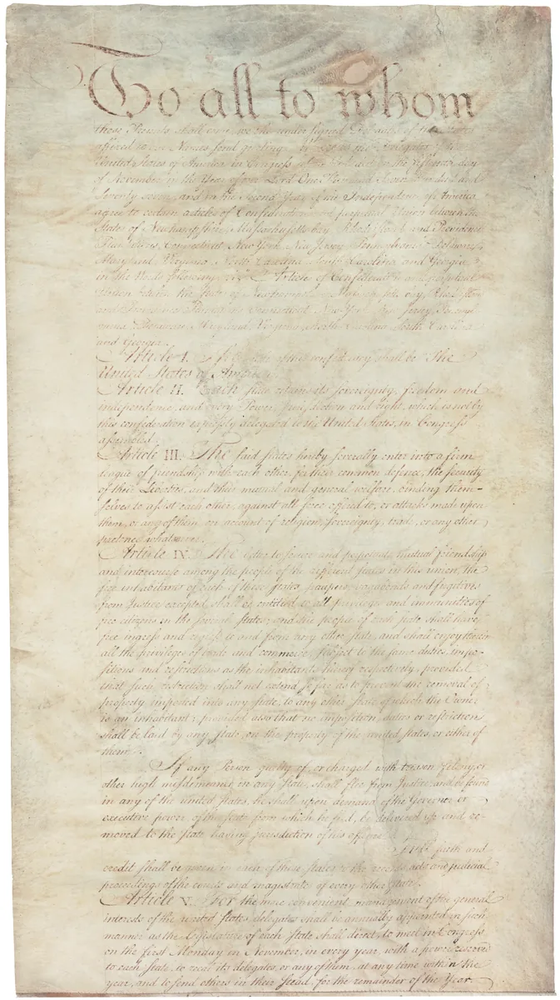 `public/images/civics/articles-of-confederation.webp` | The Articles of Confederation, page 1 | <https://catalog.archives.gov/id/301687> | Use restriction: Unrestricted. Access restriction: Unrestricted. |  |
| 2025-017 | The President of the United States is in charge of which branch of government? |  `public/images/civics/white-house-1906.webp` | The White House, Washington | <https://www.loc.gov/item/97509460/> | No known restrictions on publication. |  |
| 2025-018 | What part of the federal government writes laws? |  `public/images/civics/us-capitol-1875.webp` | United States Capitol | <https://www.loc.gov/item/2005684916/> | No known restrictions on publication. |  |
| 2025-019 | What are the two parts of the U.S. Congress? |  `public/images/civics/us-capitol-1875.webp` | United States Capitol | <https://www.loc.gov/item/2005684916/> | No known restrictions on publication. |  |
| 2025-020 | Name one power of the U.S. Congress. |  `public/images/civics/us-capitol-1875.webp` | United States Capitol | <https://www.loc.gov/item/2005684916/> | No known restrictions on publication. |  |
| 2025-050 | What is one part of the judicial branch? |  `public/images/civics/supreme-court-1931.webp` | The new United States Supreme Court / Schell Lewis ; Wurts Bros. Photo, N.Y.C. | <https://www.loc.gov/item/2002722643/> | No known restrictions on publication. |  |
| 2025-052 | What is the highest court in the United States? |  `public/images/civics/supreme-court-1931.webp` | The new United States Supreme Court / Schell Lewis ; Wurts Bros. Photo, N.Y.C. | <https://www.loc.gov/item/2002722643/> | No known restrictions on publication. |  |
| 2025-066 | What do we show loyalty to when we say the Pledge of Allegiance? |  `public/images/civics/american-flag-1914.webp` | FLAGS. HUGE AMERICAN FLAG | <https://www.loc.gov/item/2016865574/> | No known restrictions on publication. For more information, see Harris & Ewing Photographs - Rights and Restrictions Information https://www.loc.gov/rr/print/res/140_harr.html |  |
| 2025-076 | What war did the Americans fight to win independence from Britain? |  `public/images/civics/battle-of-lexington.webp` | The Battle of Lexington, 1775 | <https://www.loc.gov/item/2004669978/> | No known restrictions on publication. |  |
| 2025-077 | Name one reason why the Americans declared independence from Britain. |  `public/images/civics/declaration-of-independence-engraving.webp` | Declaration of Independence | <https://www.si.edu/object/npg_NPG.80.129> | Restrictions & Rights: CC0 |  |
| 2025-078 | Who wrote the Declaration of Independence? |  `public/images/civics/thomas-jefferson-edwin.webp` | Thomas Jefferson | <https://www.si.edu/object/npg_NPG.94.134> | Restrictions & Rights: CC0 |  |
| 2025-079 | When was the Declaration of Independence adopted? |  `public/images/civics/declaration-of-independence-engraving.webp` | Declaration of Independence | <https://www.si.edu/object/npg_NPG.80.129> | Restrictions & Rights: CC0 |  |
| 2025-080 | The American Revolution had many important events. Name one. |  `public/images/civics/battle-of-lexington.webp` | The Battle of Lexington, 1775 | <https://www.loc.gov/item/2004669978/> | No known restrictions on publication. |  |
| 2025-082 | What founding document was written in 1787? |  `public/images/civics/constitution-page-one.webp` | The U.S. Constitution, page 1 | <https://catalog.archives.gov/id/1667751> | Use restriction: Unrestricted. Access restriction: Unrestricted. |  |
| 2025-085 | Benjamin Franklin is famous for many things. Name one. |  `public/images/civics/benjamin-franklin-chevillet.webp` | Benjamin Franklin | <https://www.si.edu/object/npg_NPG.77.219> | Restrictions & Rights: CC0 |  |
| 2025-086 | George Washington is famous for many things. Name one. |  `public/images/civics/george-washington-peale.webp` | George Washington | <https://www.si.edu/object/npg_NPG.65.59> | Restrictions & Rights: CC0 |  |
| 2025-087 | Thomas Jefferson is famous for many things. Name one. |  `public/images/civics/thomas-jefferson-edwin.webp` | Thomas Jefferson | <https://www.si.edu/object/npg_NPG.94.134> | Restrictions & Rights: CC0 |  |
| 2025-088 | James Madison is famous for many things. Name one. | 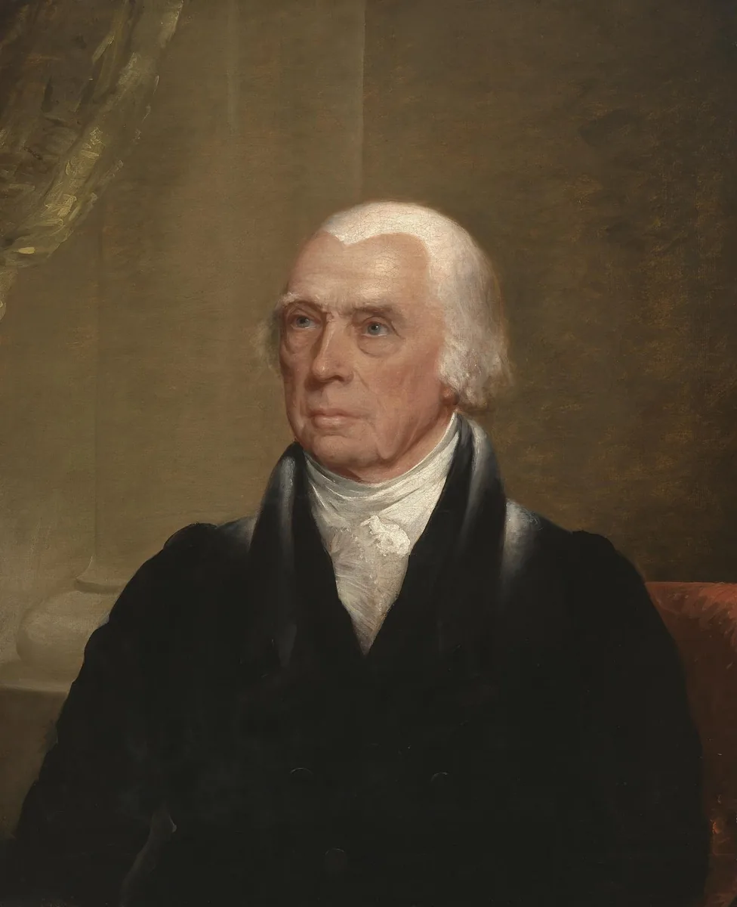 `public/images/civics/james-madison-harding.webp` | James Madison | <https://www.si.edu/object/npg_NPG.68.50> | Restrictions & Rights: CC0 |  |
| 2025-089 | Alexander Hamilton is famous for many things. Name one. | 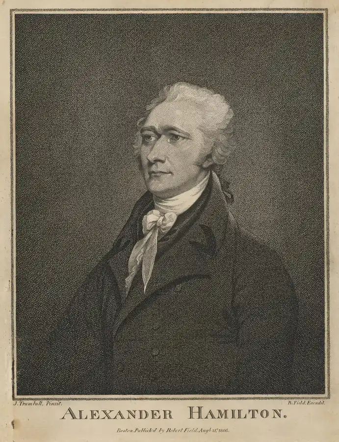 `public/images/civics/alexander-hamilton-field.webp` | Alexander Hamilton | <https://www.si.edu/object/npg_NPG.77.328> | Restrictions & Rights: CC0 |  |
| 2025-090 | What territory did the United States buy from France in 1803? |  `public/images/civics/louisiana-purchase.webp` | From the Louisiana Purchase papers, 1803 | <https://catalog.archives.gov/id/299807> | Use restriction: Unrestricted. Access restriction: Unrestricted. |  |
| 2025-091 | Name one war fought by the United States in the 1800s. |  `public/images/civics/battle-of-gettysburg.webp` | The Battle of Gettysburg, 1863 | <https://www.loc.gov/item/2006678602/> | No known restrictions on publication. |  |
| 2025-092 | Name the U.S. war between the North and the South. |  `public/images/civics/battle-of-gettysburg.webp` | The Battle of Gettysburg, 1863 | <https://www.loc.gov/item/2006678602/> | No known restrictions on publication. |  |
| 2025-093 | The Civil War had many important events. Name one. |  `public/images/civics/battle-of-gettysburg.webp` | The Battle of Gettysburg, 1863 | <https://www.loc.gov/item/2006678602/> | No known restrictions on publication. |  |
| 2025-094 | Abraham Lincoln is famous for many things. Name one. |  `public/images/civics/abraham-lincoln-healy.webp` | Abraham Lincoln | <https://www.si.edu/object/npg_NPG.65.50> | Restrictions & Rights: CC0 |  |
| 2025-095 | What did the Emancipation Proclamation do? |  `public/images/civics/emancipation-proclamation-print.webp` | Emancipation Proclamation | <https://www.si.edu/object/npg_NPG.81.47> | Restrictions & Rights: CC0 |  |
| 2025-096 | What U.S. war ended slavery? |  `public/images/civics/battle-of-gettysburg.webp` | The Battle of Gettysburg, 1863 | <https://www.loc.gov/item/2006678602/> | No known restrictions on publication. |  |
| 2025-097 | What amendment says all persons born or naturalized in the United States, and subject to the jurisdiction thereof, are U.S. citizens? |  `public/images/civics/fourteenth-amendment.webp` | The 14th Amendment, as proposed by Congress | <https://catalog.archives.gov/id/1408913> | Use restriction: Unrestricted. Access restriction: Unrestricted. |  |
| 2025-098 | When did all men get the right to vote? |  `public/images/civics/fifteenth-amendment.webp` | The 15th Amendment, as proposed by Congress | <https://catalog.archives.gov/id/299797> | Use restriction: Unrestricted. Access restriction: Unrestricted. |  |
| 2025-099 | Name one leader of the women’s rights movement in the 1800s. |  `public/images/civics/susan-b-anthony-sarony.webp` | Susan B. Anthony | <https://www.loc.gov/item/2012646556/> | No known restrictions on publication. |  |
| 2025-100 | Name one war fought by the United States in the 1900s. |  `public/images/civics/world-war-one-trench.webp` | U.S. soldiers in a trench in France, World War I | <https://www.loc.gov/item/2014705883/> | No known restrictions on publication. For more information, see George Grantham Bain Collection - Rights and Restrictions Information https://www.loc.gov/rr/print/res/274_bain.html |  |
| 2025-101 | Why did the United States enter World War I? |  `public/images/civics/world-war-one-trench.webp` | U.S. soldiers in a trench in France, World War I | <https://www.loc.gov/item/2014705883/> | No known restrictions on publication. For more information, see George Grantham Bain Collection - Rights and Restrictions Information https://www.loc.gov/rr/print/res/274_bain.html |  |
| 2025-102 | When did all women get the right to vote? | 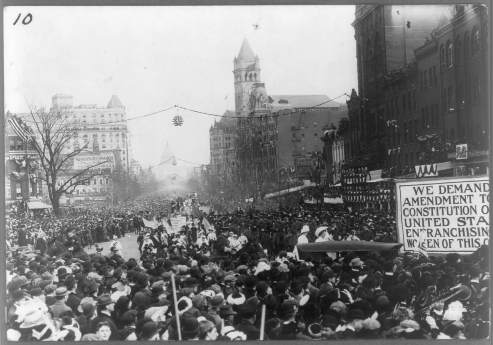 `public/images/civics/suffrage-parade-1913.webp` | A parade for women's right to vote, Washington, 1913 | <https://www.loc.gov/item/2013648100/> | No known restrictions on publication. |  |
| 2025-105 | Who was president during the Great Depression and World War II? |  `public/images/civics/franklin-d-roosevelt-hubbell.webp` | Franklin D. Roosevelt | <https://www.si.edu/object/npg_NPG.66.68> | Restrictions & Rights: CC0 |  |
| 2025-107 | Dwight Eisenhower is famous for many things. Name one. |  `public/images/civics/dwight-d-eisenhower-warnecke.webp` | Dwight D. Eisenhower | <https://www.si.edu/object/npg_NPG.94.45> | Restrictions & Rights: CC0 |  |
| 2025-112 | What did the civil rights movement do? |  `public/images/civics/march-on-washington-1963.webp` | The March on Washington for civil rights, 1963 | <https://catalog.archives.gov/id/542045> | Use restriction: Unrestricted. Access restriction: Unrestricted. |  |
| 2025-113 | Martin Luther King, Jr. is famous for many things. Name one. |  `public/images/civics/martin-luther-king-march-1963.webp` | Dr. Martin Luther King, Jr. at the March on Washington, 1963 | <https://catalog.archives.gov/id/542069> | Use restriction: Unrestricted. Access restriction: Unrestricted. |  |
| 2025-118 | Name one example of an American innovation. | 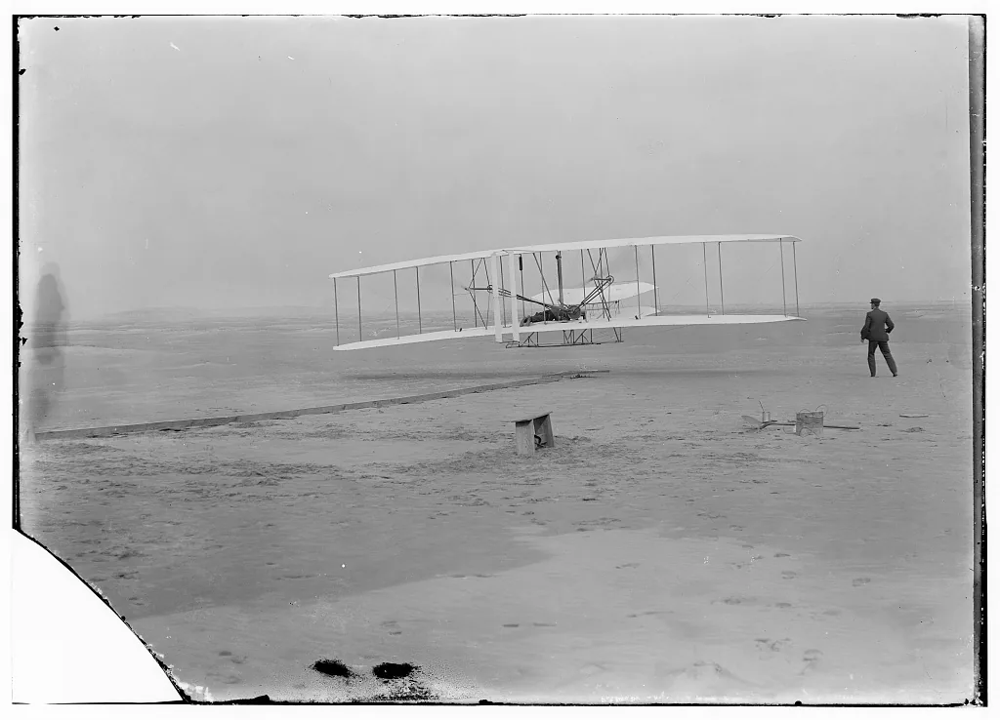 `public/images/civics/wright-first-flight.webp` | The first airplane flight, Kitty Hawk, 1903 | <https://www.loc.gov/item/00652085/> | No known restrictions on publication. |  |
| 2025-119 | What is the capital of the United States? |  `public/images/civics/washington-monument-1889.webp` | Washington Monument | <https://www.loc.gov/item/2007680368/> | No known restrictions on publication. |  |
| 2025-120 | Where is the Statue of Liberty? |  `public/images/civics/statue-of-liberty-1885.webp` | Statue of "Liberty Enlightening the World" | <https://www.loc.gov/item/2002715404/> | No known restrictions on publication. |  |
| 2025-121 | Why does the flag have 13 stripes? |  `public/images/civics/american-flag-1914.webp` | FLAGS. HUGE AMERICAN FLAG | <https://www.loc.gov/item/2016865574/> | No known restrictions on publication. For more information, see Harris & Ewing Photographs - Rights and Restrictions Information https://www.loc.gov/rr/print/res/140_harr.html |  |
| 2025-123 | What is the name of the national anthem? |  `public/images/civics/star-spangled-banner-music.webp` | The star spangled banner / written by Francis S. Key, Esq. of Georgetown, (D.C.) in 1814. | <https://www.loc.gov/item/2012649666/> | No known restrictions on publication. |  |
| 2025-127 | What is Memorial Day? | 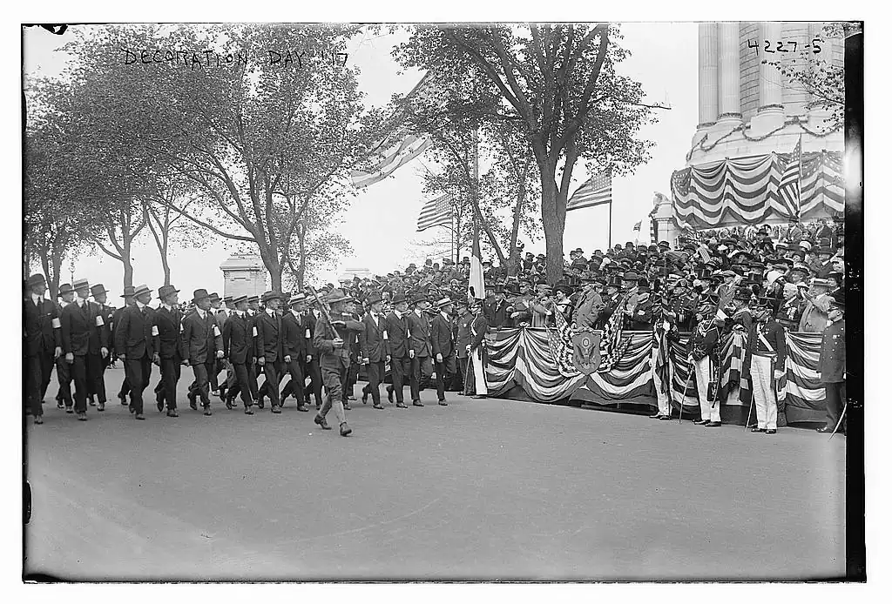 `public/images/civics/decoration-day-1917.webp` | Decoration Day (Memorial Day), 1917 | <https://www.loc.gov/item/2014704703/> | No known restrictions on publication. For more information, see George Grantham Bain Collection - Rights and Restrictions Information https://www.loc.gov/rr/print/res/274_bain.html |  |
| 2025-128 | What is Veterans Day? |  `public/images/civics/armistice-day-1922.webp` | Armistice Day (Veterans Day), 1922 | <https://www.loc.gov/item/2002697245/> | No known restrictions on publication. |  |

## AI illustrations (CONCEPT questions only)

None made yet. Run `node --no-warnings tools/images/generate-illustrations.mjs --run`, then review them here and set `reviewed: true` in `data/images/illustrations-manifest.json` for each one you approve.

## Questions without a picture

2008-004, 2008-006, 2008-007, 2008-010, 2008-011, 2008-012, 2008-013, 2008-014, 2008-018, 2008-019, 2008-020, 2008-021, 2008-022, 2008-023, 2008-024, 2008-025, 2008-026, 2008-027, 2008-028, 2008-029, 2008-030, 2008-031, 2008-032, 2008-033, 2008-034, 2008-035, 2008-036, 2008-037, 2008-039, 2008-040, 2008-041, 2008-042, 2008-043, 2008-044, 2008-045, 2008-046, 2008-047, 2008-048, 2008-049, 2008-050, 2008-051, 2008-053, 2008-054, 2008-055, 2008-056, 2008-057, 2008-058, 2008-059, 2008-060, 2008-064, 2008-067, 2008-081, 2008-083, 2008-086, 2008-087, 2008-088, 2008-089, 2008-090, 2008-091, 2008-092, 2008-093, 2008-097, 2008-099, 2008-100, 2025-001, 2025-005, 2025-007, 2025-010, 2025-012, 2025-013, 2025-015, 2025-016, 2025-021, 2025-022, 2025-023, 2025-024, 2025-025, 2025-026, 2025-027, 2025-028, 2025-029, 2025-030, 2025-031, 2025-032, 2025-033, 2025-034, 2025-035, 2025-036, 2025-037, 2025-038, 2025-039, 2025-040, 2025-041, 2025-042, 2025-043, 2025-044, 2025-045, 2025-046, 2025-047, 2025-048, 2025-049, 2025-051, 2025-053, 2025-054, 2025-055, 2025-056, 2025-057, 2025-058, 2025-059, 2025-060, 2025-061, 2025-062, 2025-063, 2025-064, 2025-065, 2025-067, 2025-068, 2025-069, 2025-070, 2025-071, 2025-072, 2025-073, 2025-074, 2025-075, 2025-081, 2025-083, 2025-084, 2025-103, 2025-104, 2025-106, 2025-108, 2025-109, 2025-110, 2025-111, 2025-114, 2025-115, 2025-116, 2025-117, 2025-122, 2025-124, 2025-125, 2025-126
