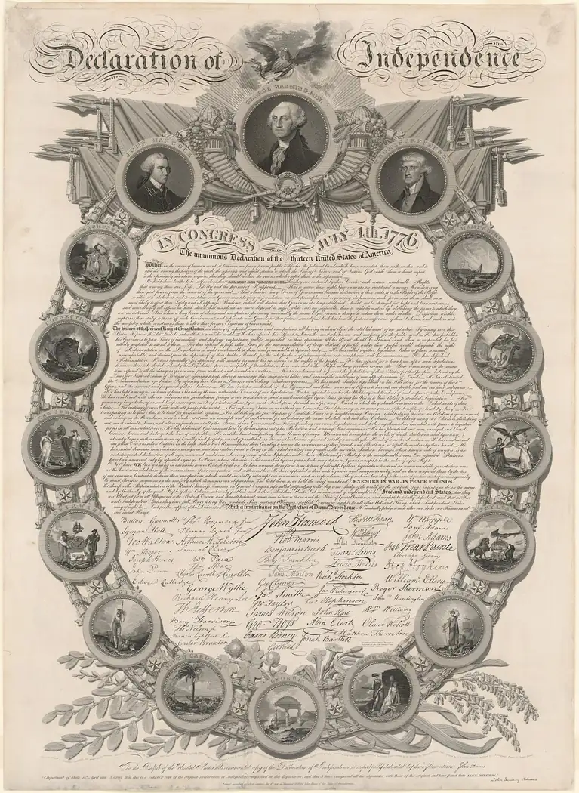
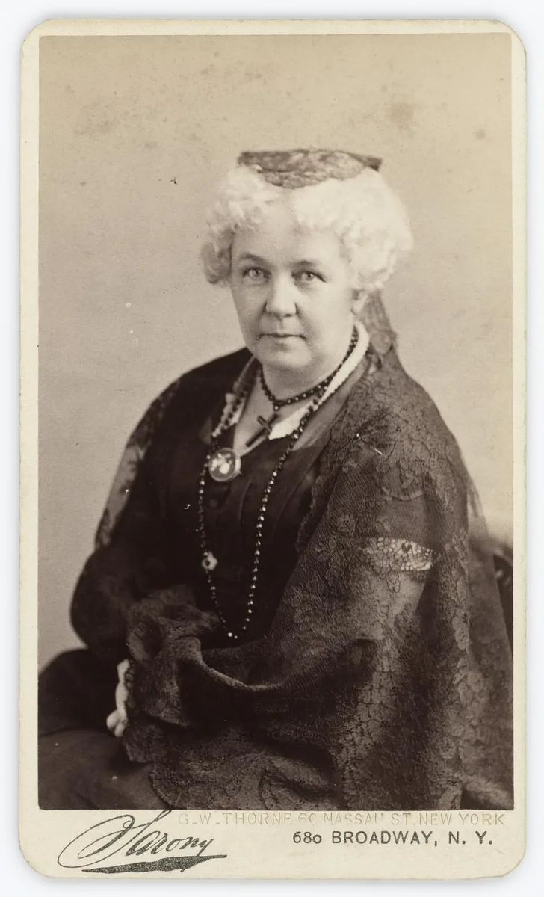

# Image review

<!-- Generated by tools/images/build-images.mjs from data/images/*.json. Do not edit by hand. -->

Every pairing of a civics question and a picture, for the owner to check. `question-images.json` is marked `needsHumanReview`: a picture is shown only after the answer is graded and in Study first, but a wrong pairing would still mislead. Check that each picture fits the question and does not suggest a wrong answer.

27 of 228 questions have a picture.

| Question | Text | Picture | Caption | Source | Rights |
|---|---|---|---|---|---|
| 2008-008 | What did the Declaration of Independence do? |  `public/images/civics/declaration-of-independence-engraving.webp` | Declaration of Independence | <https://www.si.edu/object/npg_NPG.80.129> | Smithsonian Open Access record states usage access "CC0" (Creative Commons Zero, public domain dedication) |
| 2008-009 | What are two rights in the Declaration of Independence? |  `public/images/civics/declaration-of-independence-engraving.webp` | Declaration of Independence | <https://www.si.edu/object/npg_NPG.80.129> | Smithsonian Open Access record states usage access "CC0" (Creative Commons Zero, public domain dedication) |
| 2008-062 | Who wrote the Declaration of Independence? |  `public/images/civics/thomas-jefferson-edwin.webp` | Thomas Jefferson | <https://www.si.edu/object/npg_NPG.94.134> | Smithsonian Open Access record states usage access "CC0" (Creative Commons Zero, public domain dedication) |
| 2008-063 | When was the Declaration of Independence adopted? |  `public/images/civics/declaration-of-independence-engraving.webp` | Declaration of Independence | <https://www.si.edu/object/npg_NPG.80.129> | Smithsonian Open Access record states usage access "CC0" (Creative Commons Zero, public domain dedication) |
| 2008-068 | What is one thing Benjamin Franklin is famous for? |  `public/images/civics/benjamin-franklin-chevillet.webp` | Benjamin Franklin | <https://www.si.edu/object/npg_NPG.77.219> | Smithsonian Open Access record states usage access "CC0" (Creative Commons Zero, public domain dedication) |
| 2008-069 | Who is the “Father of Our Country”? |  `public/images/civics/george-washington-peale.webp` | George Washington | <https://www.si.edu/object/npg_NPG.65.59> | Smithsonian Open Access record states usage access "CC0" (Creative Commons Zero, public domain dedication) |
| 2008-070 | Who was the first President? |  `public/images/civics/george-washington-peale.webp` | George Washington | <https://www.si.edu/object/npg_NPG.65.59> | Smithsonian Open Access record states usage access "CC0" (Creative Commons Zero, public domain dedication) |
| 2008-075 | What was one important thing that Abraham Lincoln did? |  `public/images/civics/abraham-lincoln-healy.webp` | Abraham Lincoln | <https://www.si.edu/object/npg_NPG.65.50> | Smithsonian Open Access record states usage access "CC0" (Creative Commons Zero, public domain dedication) |
| 2008-076 | What did the Emancipation Proclamation do? |  `public/images/civics/emancipation-proclamation-print.webp` | Emancipation Proclamation | <https://www.si.edu/object/npg_NPG.81.47> | Smithsonian Open Access record states usage access "CC0" (Creative Commons Zero, public domain dedication) |
| 2008-079 | Who was President during World War I? |  `public/images/civics/woodrow-wilson-tarbell.webp` | Woodrow Wilson | <https://www.si.edu/object/npg_NPG.65.42> | Smithsonian Open Access record states usage access "CC0" (Creative Commons Zero, public domain dedication) |
| 2008-080 | Who was President during the Great Depression and World War II? |  `public/images/civics/franklin-d-roosevelt-hubbell.webp` | Franklin D. Roosevelt | <https://www.si.edu/object/npg_NPG.66.68> | Smithsonian Open Access record states usage access "CC0" (Creative Commons Zero, public domain dedication) |
| 2008-082 | Before he was President, Eisenhower was a general. What war was he in? |  `public/images/civics/dwight-d-eisenhower-warnecke.webp` | Dwight D. Eisenhower | <https://www.si.edu/object/npg_NPG.94.45> | Smithsonian Open Access record states usage access "CC0" (Creative Commons Zero, public domain dedication) |
| 2025-008 | Why is the Declaration of Independence important? |  `public/images/civics/declaration-of-independence-engraving.webp` | Declaration of Independence | <https://www.si.edu/object/npg_NPG.80.129> | Smithsonian Open Access record states usage access "CC0" (Creative Commons Zero, public domain dedication) |
| 2025-009 | What founding document said the American colonies were free from Britain? |  `public/images/civics/declaration-of-independence-engraving.webp` | Declaration of Independence | <https://www.si.edu/object/npg_NPG.80.129> | Smithsonian Open Access record states usage access "CC0" (Creative Commons Zero, public domain dedication) |
| 2025-011 | The words “Life, Liberty, and the pursuit of Happiness” are in what founding document? |  `public/images/civics/declaration-of-independence-engraving.webp` | Declaration of Independence | <https://www.si.edu/object/npg_NPG.80.129> | Smithsonian Open Access record states usage access "CC0" (Creative Commons Zero, public domain dedication) |
| 2025-078 | Who wrote the Declaration of Independence? |  `public/images/civics/thomas-jefferson-edwin.webp` | Thomas Jefferson | <https://www.si.edu/object/npg_NPG.94.134> | Smithsonian Open Access record states usage access "CC0" (Creative Commons Zero, public domain dedication) |
| 2025-079 | When was the Declaration of Independence adopted? |  `public/images/civics/declaration-of-independence-engraving.webp` | Declaration of Independence | <https://www.si.edu/object/npg_NPG.80.129> | Smithsonian Open Access record states usage access "CC0" (Creative Commons Zero, public domain dedication) |
| 2025-085 | Benjamin Franklin is famous for many things. Name one. |  `public/images/civics/benjamin-franklin-chevillet.webp` | Benjamin Franklin | <https://www.si.edu/object/npg_NPG.77.219> | Smithsonian Open Access record states usage access "CC0" (Creative Commons Zero, public domain dedication) |
| 2025-086 | George Washington is famous for many things. Name one. |  `public/images/civics/george-washington-peale.webp` | George Washington | <https://www.si.edu/object/npg_NPG.65.59> | Smithsonian Open Access record states usage access "CC0" (Creative Commons Zero, public domain dedication) |
| 2025-087 | Thomas Jefferson is famous for many things. Name one. |  `public/images/civics/thomas-jefferson-edwin.webp` | Thomas Jefferson | <https://www.si.edu/object/npg_NPG.94.134> | Smithsonian Open Access record states usage access "CC0" (Creative Commons Zero, public domain dedication) |
| 2025-088 | James Madison is famous for many things. Name one. |  `public/images/civics/james-madison-harding.webp` | James Madison | <https://www.si.edu/object/npg_NPG.68.50> | Smithsonian Open Access record states usage access "CC0" (Creative Commons Zero, public domain dedication) |
| 2025-089 | Alexander Hamilton is famous for many things. Name one. |  `public/images/civics/alexander-hamilton-field.webp` | Alexander Hamilton | <https://www.si.edu/object/npg_NPG.77.328> | Smithsonian Open Access record states usage access "CC0" (Creative Commons Zero, public domain dedication) |
| 2025-094 | Abraham Lincoln is famous for many things. Name one. |  `public/images/civics/abraham-lincoln-healy.webp` | Abraham Lincoln | <https://www.si.edu/object/npg_NPG.65.50> | Smithsonian Open Access record states usage access "CC0" (Creative Commons Zero, public domain dedication) |
| 2025-095 | What did the Emancipation Proclamation do? |  `public/images/civics/emancipation-proclamation-print.webp` | Emancipation Proclamation | <https://www.si.edu/object/npg_NPG.81.47> | Smithsonian Open Access record states usage access "CC0" (Creative Commons Zero, public domain dedication) |
| 2025-099 | Name one leader of the women’s rights movement in the 1800s. |  `public/images/civics/elizabeth-cady-stanton-sarony.webp` | Elizabeth Cady Stanton | <https://www.si.edu/object/npg_NPG.78.253> | Smithsonian Open Access record states usage access "CC0" (Creative Commons Zero, public domain dedication) |
| 2025-105 | Who was president during the Great Depression and World War II? |  `public/images/civics/franklin-d-roosevelt-hubbell.webp` | Franklin D. Roosevelt | <https://www.si.edu/object/npg_NPG.66.68> | Smithsonian Open Access record states usage access "CC0" (Creative Commons Zero, public domain dedication) |
| 2025-107 | Dwight Eisenhower is famous for many things. Name one. |  `public/images/civics/dwight-d-eisenhower-warnecke.webp` | Dwight D. Eisenhower | <https://www.si.edu/object/npg_NPG.94.45> | Smithsonian Open Access record states usage access "CC0" (Creative Commons Zero, public domain dedication) |

## Questions without a picture

2008-001, 2008-002, 2008-003, 2008-004, 2008-005, 2008-006, 2008-007, 2008-010, 2008-011, 2008-012, 2008-013, 2008-014, 2008-015, 2008-016, 2008-017, 2008-018, 2008-019, 2008-020, 2008-021, 2008-022, 2008-023, 2008-024, 2008-025, 2008-026, 2008-027, 2008-028, 2008-029, 2008-030, 2008-031, 2008-032, 2008-033, 2008-034, 2008-035, 2008-036, 2008-037, 2008-038, 2008-039, 2008-040, 2008-041, 2008-042, 2008-043, 2008-044, 2008-045, 2008-046, 2008-047, 2008-048, 2008-049, 2008-050, 2008-051, 2008-052, 2008-053, 2008-054, 2008-055, 2008-056, 2008-057, 2008-058, 2008-059, 2008-060, 2008-061, 2008-064, 2008-065, 2008-066, 2008-067, 2008-071, 2008-072, 2008-073, 2008-074, 2008-077, 2008-078, 2008-081, 2008-083, 2008-084, 2008-085, 2008-086, 2008-087, 2008-088, 2008-089, 2008-090, 2008-091, 2008-092, 2008-093, 2008-094, 2008-095, 2008-096, 2008-097, 2008-098, 2008-099, 2008-100, 2025-001, 2025-002, 2025-003, 2025-004, 2025-005, 2025-006, 2025-007, 2025-010, 2025-012, 2025-013, 2025-014, 2025-015, 2025-016, 2025-017, 2025-018, 2025-019, 2025-020, 2025-021, 2025-022, 2025-023, 2025-024, 2025-025, 2025-026, 2025-027, 2025-028, 2025-029, 2025-030, 2025-031, 2025-032, 2025-033, 2025-034, 2025-035, 2025-036, 2025-037, 2025-038, 2025-039, 2025-040, 2025-041, 2025-042, 2025-043, 2025-044, 2025-045, 2025-046, 2025-047, 2025-048, 2025-049, 2025-050, 2025-051, 2025-052, 2025-053, 2025-054, 2025-055, 2025-056, 2025-057, 2025-058, 2025-059, 2025-060, 2025-061, 2025-062, 2025-063, 2025-064, 2025-065, 2025-066, 2025-067, 2025-068, 2025-069, 2025-070, 2025-071, 2025-072, 2025-073, 2025-074, 2025-075, 2025-076, 2025-077, 2025-080, 2025-081, 2025-082, 2025-083, 2025-084, 2025-090, 2025-091, 2025-092, 2025-093, 2025-096, 2025-097, 2025-098, 2025-100, 2025-101, 2025-102, 2025-103, 2025-104, 2025-106, 2025-108, 2025-109, 2025-110, 2025-111, 2025-112, 2025-113, 2025-114, 2025-115, 2025-116, 2025-117, 2025-118, 2025-119, 2025-120, 2025-121, 2025-122, 2025-123, 2025-124, 2025-125, 2025-126, 2025-127, 2025-128
